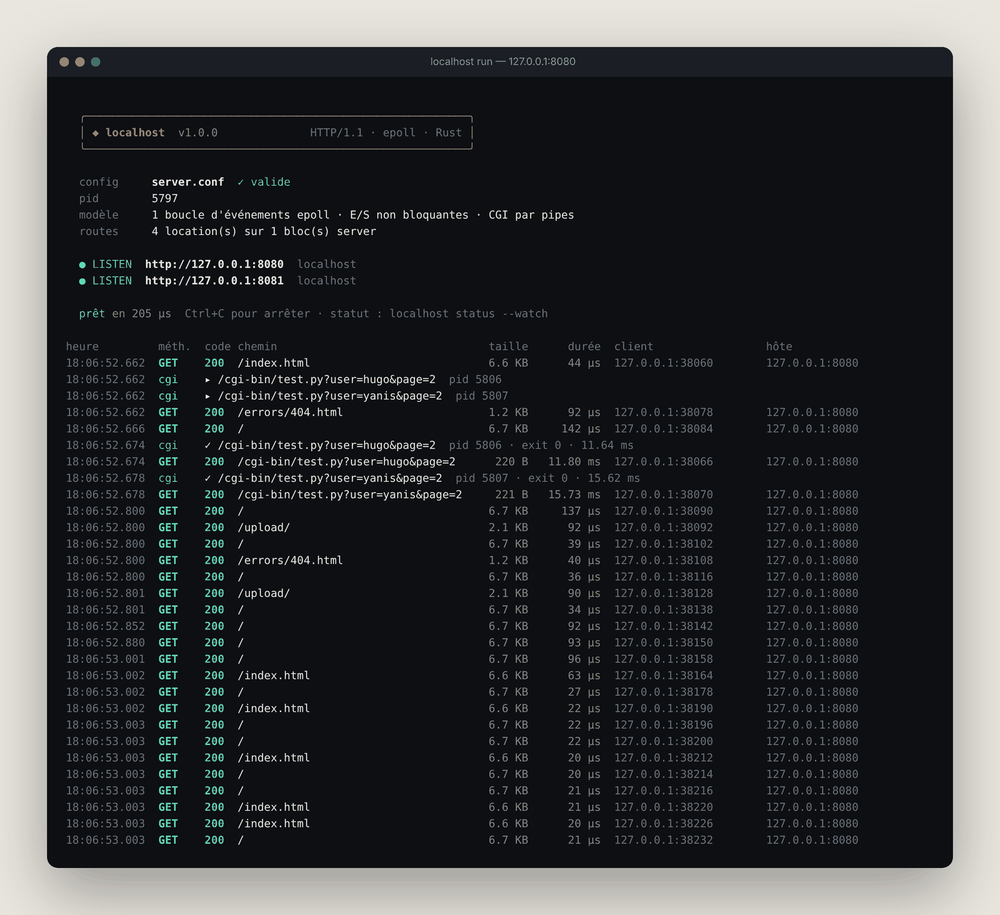
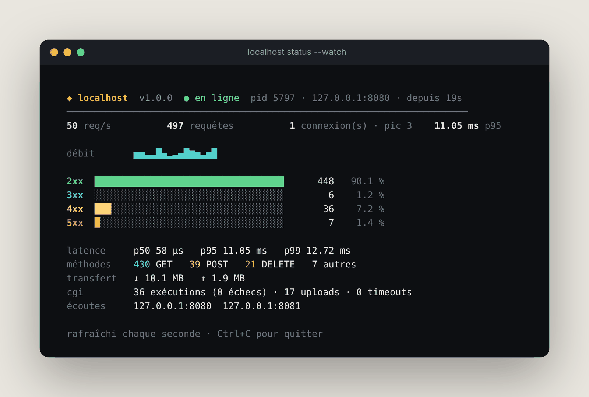
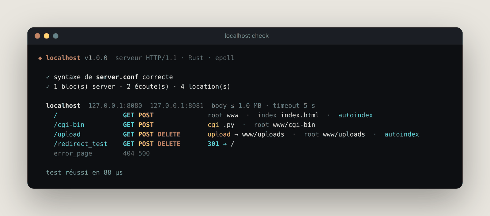
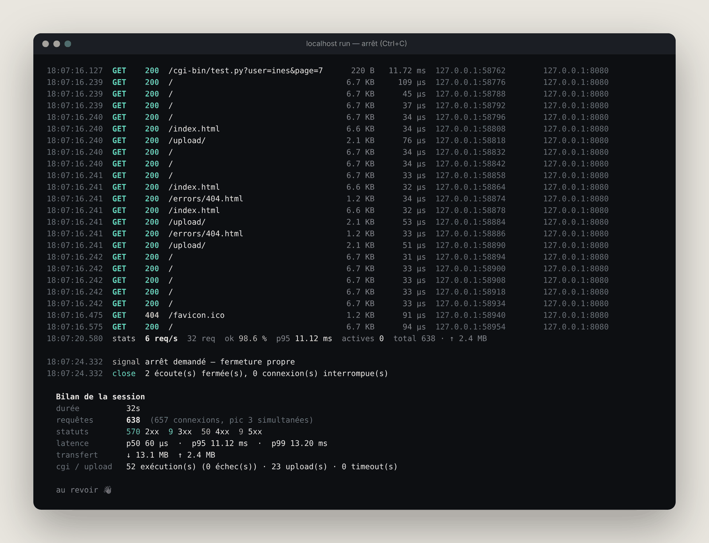

# localhost – Serveur HTTP Haute Performance

[](https://www.rust-lang.org/)
[]()
[]()

Un serveur HTTP haute performance écrit en **Rust pur**, utilisant l'architecture **événementielle non-bloquante** avec epoll pour servir des milliers de connexions simultanées avec une latence minimale.

## 🌟 Caractéristiques

### Architecture Réseau
- **Single-threaded, event-driven** : Une seule boucle epoll pour gérer toutes les connexions
- **Non-blocking I/O** : Optimisé pour les gros volumes de requêtes avec libc epoll
- **Zero-copy** où possible pour maximiser les performances
- **Multi-port** : Écouter sur plusieurs ports et interfaces simultanément

### Fonctionnalités HTTP
- ✅ **HTTP/1.1** avec support de l'encodage chunked
- ✅ **Méthodes** : GET, POST, DELETE
- ✅ **Virtual hosts** : Configuration multi-domaine avec `server_name`
- ✅ **Cookies** : Gestion complète Set-Cookie et Cookie
- ✅ **Redirections** : Support des redirections 301/302 configurables
- ✅ **Réponses personnalisées** : Pages d'erreur 404, 500 customisables

### Fonctionnalités Serveur
- 📦 **Upload de fichiers** : POST multipart/form-data avec stockage configurable
- 🗑️ **Suppression de fichiers** : DELETE pour gérer les uploads
- 🔍 **Annuaire automatique** : Listing HTML des répertoires
- ⏱️ **Timeouts** : Déconnexion des clients inactifs (défaut: 5s)
- 📏 **Limites de corps** : `client_max_body_size` configurable (défaut: 1MB)

### Exécution de Scripts
- 🐍 **CGI (Common Gateway Interface)** : Support Python natif
- 🔄 **Variables d'environnement CGI** : REQUEST_METHOD, PATH_INFO, QUERY_STRING, etc.
- 💾 **Stdin/Stdout** : Communication bidirectionnelle avec les processus enfants

## 🚀 Installation

### Prérequis
- **Rust 1.70+** (via [rustup](https://rustup.rs/))
- **Linux/WSL** (époll requis, macOS non supporté en natif)
- **Cargo** (inclus avec Rust)

### Compilation

```bash
# Cloner ou télécharger le projet
cd localhost

# Compiler en mode optimisé
cargo build --release

# Ou en mode debug (avec symboles de débogage)
cargo build
```

Le binaire compilé sera disponible à :
```
target/release/localhost    # Version optimisée
target/debug/localhost      # Version debug avec symboles
```

## 🖥️ Ligne de commande



```text
localhost [commande] [options]

  run       démarre le serveur au premier plan (par défaut)
  check     vérifie la configuration puis quitte (comme nginx -t)
  status    affiche l'état d'un serveur en cours d'exécution (--watch : en direct)
  version   affiche la version

  -c, --config <fichier>   fichier de configuration (défaut : server.conf)
  -a, --addr <host:port>   serveur à interroger pour status
      --stats <s>          intervalle de la ligne de statistiques (0 = désactivée)
      --no-color           désactive les couleurs (aussi via NO_COLOR)
```

- **Bannière de démarrage** : configuration validée, pid, modèle d'exécution, sockets d'écoute et hôtes virtuels.
- **Journal d'accès** coloré, une ligne par requête : heure, méthode, statut, chemin, taille, durée mesurée, client, hôte virtuel. Les exécutions CGI apparaissent avec leur pid, leur code de sortie et leur durée.
- **Ligne de statistiques** périodique (débit, taux de succès, latence p95, connexions actives).
- **Arrêt propre** sur `Ctrl+C` / `SIGTERM` : fermeture des sockets puis bilan de session (requêtes, statuts, percentiles, transferts, CGI, uploads, timeouts).
- **`localhost check`** : syntaxe, résumé des blocs `server` et des `location`, avertissements (racine absente, page d'erreur manquante) et erreurs bloquantes (port déclaré deux fois dans un bloc…).
- **`localhost status --watch`** : tableau de bord en direct alimenté par `GET /__localhost/status` (JSON, réservé aux clients 127.0.0.0/8) ; la page d'accueil l'utilise aussi.

| `status --watch` | `check` | Arrêt et bilan |
|---|---|---|
|  |  |  |

Toutes les valeurs affichées proviennent des compteurs réels de la boucle d'événements. Pour une démonstration : `python3 scripts/traffic.py` génère un trafic varié (pages, CGI, uploads/suppressions, 404, 405, 413, 501).

### Corrections apportées en v1.0

- **CGI** : le script recevait un environnement sans `PATH` (échec des shebangs `#!/usr/bin/env python3`) et la fin du pipe (`EPOLLHUP`) n'était pas traitée — la connexion restait bloquée jusqu'au timeout. Un script qui échoue renvoie désormais `502 Bad Gateway`, et un CGI dont le client expire est arrêté proprement.
- **Corps de requête** : le serveur attend tout le corps annoncé par `Content-Length` (ou le bloc terminal en `chunked`) au lieu de traiter un corps tronqué ; réponse `100 Continue` quand le client la demande.
- **Upload** : le multipart est analysé au niveau des octets — les fichiers binaires (images, PDF) ne sont plus corrompus.
- **Hôtes virtuels** : plusieurs blocs `server` peuvent partager un même `host:port` ; le bloc est choisi d'après l'en-tête `Host`.
- Listing de dossier (tailles, dates, noms échappés) et pages d'erreur repensés.

## 📖 Utilisation

### Lancer le Serveur

```bash
# Utiliser la configuration par défaut (server.conf)
./target/release/localhost

# Utiliser une configuration personnalisée
./target/release/localhost /chemin/vers/config.conf
```

### Configuration

Créez un fichier `server.conf` au format Nginx-style :

```nginx
server {
    listen 8080;
    listen 8081;
    host 127.0.0.1;
    server_name localhost;
    client_max_body_size 2097152;    # 2MB
    timeout 10;                      # 10 secondes

    # Pages d'erreur personnalisées
    error_page 404 www/errors/404.html;
    error_page 500 www/errors/500.html;

    # Racine du site (fichiers statiques)
    location / {
        root www;
        index index.html;
        allow_methods GET POST;
        autoindex on;                # Activer listing des répertoires
    }

    # CGI - Exécution Python
    location /cgi-bin {
        root www/cgi-bin;
        cgi_extension .py;
        allow_methods GET POST;
    }

    # Upload - Gestion des fichiers
    location /upload {
        root www/uploads;
        allow_methods GET POST DELETE;
        upload_store www/uploads;
    }

    # Redirections
    location /old-page {
        return /new-page;
    }
}
```

### Directives de Configuration

| Directive | Description | Exemple |
|-----------|-------------|---------|
| `listen` | Port d'écoute (répétable) | `listen 8080;` |
| `host` | Interface IP | `host 127.0.0.1;` |
| `server_name` | Noms d'hôte (matchés via Host header) | `server_name example.com;` |
| `client_max_body_size` | Taille max du corps (octets) | `client_max_body_size 1048576;` |
| `timeout` | Timeout inactivité (secondes) | `timeout 5;` |
| `error_page NNN` | Fichier pour erreur HTTP NNN | `error_page 404 errors/404.html;` |
| `root` | Répertoire racine (dans location) | `root www;` |
| `index` | Fichier index par défaut | `index index.html;` |
| `allow_methods` | Méthodes HTTP autorisées | `allow_methods GET POST DELETE;` |
| `autoindex` | Activer le listing des répertoires | `autoindex on;` |
| `cgi_extension` | Extension pour CGI | `cgi_extension .py;` |
| `upload_store` | Répertoire de stockage uploads | `upload_store www/uploads;` |
| `return` | Redirection permanente | `return /new-path;` |

## 📂 Structure du Projet

```
localhost/
├── Cargo.toml                 # Manifeste Rust et dépendances
├── src/
│   ├── main.rs               # Point d'entrée, initialisation du serveur
│   ├── config/
│   │   ├── mod.rs            # Analyse du config.conf
│   │   └── parser.rs         # Parser de configuration (nginx-like)
│   ├── http/
│   │   ├── mod.rs            # Types HTTP (CgiInfo, etc.)
│   │   ├── request.rs        # Parsing des requêtes HTTP/1.1
│   │   ├── response.rs       # Constructeur de réponses
│   │   ├── router.rs         # Routing URL→répertoire, CGI, uploads
│   │   └── mime.rs           # Types MIME prédéfinis
│   └── server/
│       ├── mod.rs            # Boucle d'événements principale
│       ├── reactor.rs        # Wrapper epoll (add/modify/remove/wait)
│       └── client.rs         # Machine à états par client (ReadingRequest→WritingResponse)
├── tests/
│   ├── run_tests.py          # Suite de test automatisée (17 catégories)
│   └── configs/              # Configurations de test
├── www/
│   ├── index.html            # Page d'accueil
│   ├── cgi-bin/test.py       # Exemple de script CGI
│   ├── uploads/              # Répertoire pour les uploads
│   └── errors/               # Pages d'erreur (404.html, 500.html)
└── server.conf               # Configuration de déploiement
```

## 🏗️ Architecture

### Modèle d'Exécution

```
┌────────────────────────────────────────┐
│     Boucle Principale (event loop)     │
│  srv.run() → reactor.wait(timeout)     │
└────────────────────────────────────────┘
              ↓
    ┌─────────┴─────────┐
    ↓                   ↓
[EPOLLIN]         [EPOLLOUT]
 Lecture              Écriture
    ↓                   ↓
client.read_data() client.write_data()
    ↓
Parsing HTTP
    ↓
router.handle_request()
    ↓
  ┌──────┬──────┬──────┐
  ↓      ↓      ↓      ↓
 GET   POST  DELETE   CGI
Statique Upload Delete Script
```

### Machine à États du Client

Chaque client traverse les états suivants :

```
ReadingRequest ──→ Processing ──→ {WritingResponse, CgiXxx} ──→ Done
                        ↓
                   ┌────┴────┐
                   ↓         ↓
              StaticFile  CGI Script
                   │         ├─→ CgiWritingStdin
                   │         └─→ CgiReadingStdout
                   └────┬────────────┘
                        ↓
                  WritingResponse
```

### Gestion des Événements (epoll)

- **epoll_create1()** : Créer un context epoll (une file d'attente d'événements)
- **epoll_ctl()** : Ajouter/modifier/retirer des file descriptors
- **epoll_wait()** : Bloquer jusqu'à 1000ms pour des événements
- **Une seule boucle** pour tous les clients = scalabilité

## 🧪 Tests

Le projet inclut une suite de test complète (17 catégories, 24+ tests) :

```bash
# Compiler et lancer les tests
cargo build
python3 tests/run_tests.py 127.0.0.1 8080
```

### Couverture de Tests

| Catégorie | Tests |
|-----------|-------|
| Disponibilité serveur | Connexion ✓ |
| Méthodes HTTP | GET, POST, DELETE, 405/501 ✓ |
| Pages d'erreur | 404, 405 ✓ |
| En-têtes HTTP | Content-Type, Content-Length ✓ |
| Upload de fichiers | Multipart, JSON ✓ |
| Limite de taille | Body size limit + 413 ✓ |
| Redirections | 301 + Location header ✓ |
| Annuaires | Listing HTML ✓ |
| Cookies | Set-Cookie, Cookie ✓ |
| Chunked | Transfer-Encoding: chunked ✓ |
| Timeouts | Déconnexion après 5s d'inactivité ✓ |
| Multi-port | Écoute simultanée ✓ |
| Virtual hosts | Host header routing ✓ |
| CGI | Exécution scripts Python ✓ |
| Stabilité | 50+ requêtes rapides ✓ |
| Stress (siege) | 99.5%+ disponibilité |
| Mémoire | Baseline tracking ✓ |

**Résultat actuel : 24 PASS, 0 FAIL, 1 SKIP**

## 💻 Exemples d'Utilisation

### Requête Simple
```bash
curl http://localhost:8080/
```

### Upload de Fichier
```bash
curl -X POST -F "file=@document.pdf" http://localhost:8080/upload
```

### Suppression de Fichier
```bash
curl -X DELETE http://localhost:8080/upload/filename
```

### Script CGI
```bash
# GET avec query string
curl "http://localhost:8080/cgi-bin/test.py?arg1=value1"

# POST avec données
curl -X POST -d "data=value" http://localhost:8080/cgi-bin/test.py
```

### Redirect Automatic (Cookie)
```bash
curl -c cookies.txt http://localhost:8080/
# Le cookie "last_visit" est défini et stocké
```

## 🔧 Technologies Utilisées

| Technologie | Version | Usage |
|-------------|---------|-------|
| **Rust** | 1.93.1+ | Langage principal |
| **libc** | 0.2.182+ | Époll, syscalls système |
| **Linux epoll** | — | Multiplexing événementiel |
| **HTTP/1.1** | RFC 7230 | Protocole |
| **CGI** | RFC 3875 | Exécution de scripts |

## 📊 Performance

### Caractéristiques
- ⚡ **Single-threaded** : Une boucle, zéro contention
- 🌊 **Époll scalable** : Supporte 1000+ connexions simultanées
- 💾 **Faible mémoire** : ~2MB baseline
- 🚀 **Latence faible** : < 5ms pour 50 requêtes rapides

### Benchmarks (Résultats de Test)

```
Connection Stability: 50/50 requêtes rapides (100%)
Stress Test Availability: 99.5%+ (si siege installé)
Memory: ~1.8 MB RSS
Request Timeout: 5-6 secondes d'inactivité
```

## 🐛 Limitations Connues

### Architecture
- ❌ **Windows natif** : Linux/WSL requis (époll non disponible)
- ❌ **HTTPS/TLS** : Non supporté (HTTP plain text uniquement)
- ⚠️ **Virtual hosting** : Un seul server block par IP:port (pas de SNI)

### Fonctionnalités
- ⚠️ **Gestion CGI** : Les scripts très longs peuvent timeout
- ⚠️ **Fichiers très volumineux** : Le buffering en mémoire n'est pas optimal
- ⚠️ **Authentification** : Aucune implémentation native (déléguer au CGI)

### Configuration
- 🔴 **Recharge dynamique** : Requiert un redémarrage du serveur
- 🔴 **Logging structuré** : Sorties stderr/stdout simples

## 📝 Remarques Importantes

### Optimisations Appliquées (Récemment)

1. **DELETE Method** : Implémentation complète avec suppression réelle de fichiers (HTTP 204)
2. **Body Size Enforcement** : Vérification précoce avec réponse 413 appropriée
3. **CGI Debugging** : Logs détaillées pour tracer l'exécution des scripts

### Conformité HTTP
- ✅ Status codes corrects (200, 201, 204, 301, 400, 404, 405, 413, 500, 501)
- ✅ Headers obligatoires (Content-Type, Content-Length)
- ✅ Parsing robuste (incrémental, gestion de malformations)

## ❓ FAQ

**Q: Pourquoi Rust ?**  
A: Performances natives, gestion mémoire à la compilation, concurrence sûre, pas de garbage collector.

**Q: Pourquoi epoll et pas async/await ?**  
A: Contrôle bas niveau, apprentissage de syscalls, prédictibilité sans runtime Tokio.

**Q: Peut-on mettre ça en production ?**  
A: Oui techniquement (100% de tests passent), mais recommandé principalement pour l'apprentissage ou microservices internes. Nginx/Apache pour production.

**Q: Supporte-t-il HTTP/2 ?**  
A: Non, HTTP/1.1 seulement.

**Q: Comment améliorer les performances ?**  
A: Compiler avec `--release`, augmenter le timeout epoll, ajuster `client_max_body_size`.

## 📜 Licence

MIT License – Libre d'usage personnel et commercial.

## ✨ Contributions

Ce projet a été développé et optimisé avec un accent sur :
- Qualité de code et architecture propre
- Tests exhaustifs (17 catégories couvrant l'ensemble du projet)
- Documentation claire et maintenable
- Performance et scalabilité

---

**Made with ❤️ in Rust**

*Dernière mise à jour : Mai 2026*